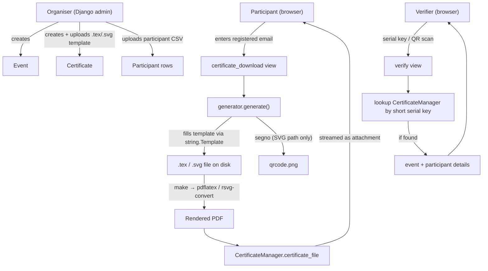
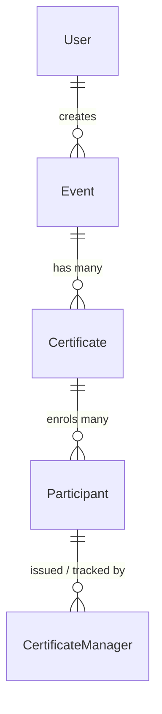

# certificate-generation
Auto generation of certificates for the particiapants of an event
# Cgen — Certificate Generation

Automatic generation, distribution, and QR-based verification of participation
certificates for events, workshops, and courses.

Built by **FOSSEE, IIT Bombay** (2023). Licensed under the **BSD 3-Clause License**.

---

## Table of contents

1. [What it does](#what-it-does)
2. [Key features](#key-features)
3. [How it works](#how-it-works)
4. [Technology stack](#technology-stack)
5. [Repository layout](#repository-layout)
6. [Data model](#data-model)
7. [Prerequisites](#prerequisites)
8. [Installation and first run](#installation-and-first-run)
9. [Configuration reference](#configuration-reference)
10. [Usage walkthrough](#usage-walkthrough)
11. [Authoring certificate templates](#authoring-certificate-templates)
12. [URL / endpoint reference](#url--endpoint-reference)
13. [The Makefile](#the-makefile)
14. [Security and operational considerations](#security-and-operational-considerations)
15. [Known issues and rough edges](#known-issues-and-rough-edges)
16. [Production hardening checklist](#production-hardening-checklist)
17. [License and credits](#license-and-credits)

---

## What it does

Cgen is a small Django web application that lets an organiser:

- Define an **Event** (a workshop, course, or conference).
- Attach one or more **Certificate** designs to that event, each backed by an
  uploaded **LaTeX** or **SVG** template.
- Bulk-load the list of attendees from a **CSV** file.
- Let each attendee fetch their own personalised certificate as a **PDF** by
  entering their registered email address.
- Stamp every certificate with a **QR code / serial key** so that anyone can
  later **verify** that a certificate is authentic.

The actual page layout and typography live entirely inside the template you
upload. Cgen's job is to fill that template with each participant's details,
render it to PDF, and serve it.

---

## Key features

- **Two template engines.** A certificate design is either a LaTeX (`.tex`)
  template compiled with `pdflatex`, or an SVG (`.svg`) template converted with
  `rsvg-convert`. You choose per certificate.
- **CSV-driven enrolment.** Upload a spreadsheet of `email`, `name`, and any
  extra columns; every column becomes a variable your template can use.
- **Self-service download.** Participants identify themselves by email — no
  user accounts required for the people receiving certificates.
- **Bulk download view for organisers.** A single page lists every participant
  of a certificate with a download link each.
- **Built-in verification.** Each certificate carries a short serial key and a
  QR code. A public verification page confirms authenticity and shows the
  event details.
- **Admin-managed.** Events, certificates, participants, and issued
  certificates are all administered through the standard Django admin site.

---

## How it works

### The actors

| Actor | Does what |
|-------|-----------|
| **Organiser / admin** | Logs into Django admin, creates the event and certificate, uploads the template and the participant CSV. |
| **Participant** | Visits the public download page, enters their email, receives a PDF. |
| **Verifier (anyone)** | Enters a serial key (or scans the QR code) to confirm a certificate is genuine. |

### Data flow



### Step by step, what happens on download

1. The participant submits their email on `/certificate/download/<certificate_id>/`.
2. `generator.get_certificate()` checks that a `Participant` exists for that
   email + certificate. If not, the page shows a "not registered" message.
3. `generator.get_details()` does the bookkeeping:
   - Gets or creates a `CertificateManager` row for that participant.
   - Generates a **SHA-1** hash of `email + certificate_id`; the full hash is
     the long serial key, and its **first 4 characters** are the short serial
     key (the one printed on the certificate).
   - Reconstructs the participant's detail dictionary and injects two extra
     variables: `serial_key` (the short key) and `qr_code` (the verification
     URL).
4. `generator.generate()` renders the certificate:
   - Reads the uploaded template and substitutes every `$variable`
     using Python's `string.Template.safe_substitute`.
   - For **SVG** templates it also builds a QR-code PNG (`qrcode.png`) pointing
     at the verification URL, using the `segno` library.
   - Invokes `make` (see [The Makefile](#the-makefile)) to run `pdflatex` or
     `rsvg-convert`, wrapped in a `timeout` so a broken template cannot hang
     the server forever.
   - Saves the resulting PDF onto the `CertificateManager` record.
5. The PDF is streamed back to the browser as a file download.

### Step by step, what happens on verification

1. A verifier enters the short serial key on `/certificate/verify/` (or hits
   `/certificate/verify/<key>/` directly, e.g. from the QR code).
2. `verification.verify()` looks up the `CertificateManager` whose
   `serial_key_short` matches.
3. If found, the page displays the event name, description, and the
   participant's stored details. If not, it shows an "invalid serial" message.

---

## Technology stack

| Layer | Choice |
|-------|--------|
| Web framework | Django 4.1.7 |
| Language | Python 3 (the pinned `backports.zoneinfo` implies a 3.8 baseline) |
| Database | SQLite (file-based, `db.sqlite3`) |
| PDF from LaTeX | A TeX distribution providing `pdflatex` |
| PDF from SVG | `rsvg-convert` (from librsvg) |
| QR codes | `segno` |
| Build glue | GNU `make` |
| Frontend | Server-rendered Django templates + Bootstrap 5 (via CDN) |

Python dependencies are pinned in `requirements.txt`:

```
asgiref==3.6.0
backports.zoneinfo==0.2.1
Django==4.1.7
Pillow==10.1.0
pypng==0.20220715.0
segno==1.5.3
sqlparse==0.4.3
typing-extensions==4.8.0
```

> **Note:** `pdflatex`, `rsvg-convert`, and `make` are **system** tools, not pip
> packages. They must be installed separately (see
> [Prerequisites](#prerequisites)).

---

## Repository layout

```
certificate-generation/
├── LICENSE                     # BSD 3-Clause
├── README.md
├── requirements.txt            # Python dependencies
└── website/                    # Django project root (BASE_DIR)
    ├── manage.py               # Django command-line entry point
    ├── Makefile                # Renders .tex/.svg → PDF
    ├── website/                # Project configuration package
    │   ├── settings.py         # Settings (imports SECRET_KEY from local.py)
    │   ├── urls.py             # URL routing
    │   ├── wsgi.py / asgi.py   # Server entry points
    │   └── __init__.py
    └── cgen/                   # The single application
        ├── models.py           # Event, Certificate, Participant, CertificateManager
        ├── views.py            # Request handlers (download, verify, upload)
        ├── generator.py        # Template filling + PDF rendering
        ├── verification.py     # Serial-key lookup
        ├── admin.py            # Registers models in Django admin
        ├── apps.py
        ├── tests.py            # (placeholder, no tests yet)
        ├── dummy.csv           # Example participant CSV
        ├── migrations/         # Database schema history (0001–0006)
        └── templates/          # HTML pages (Bootstrap)
            ├── base.html
            ├── index.html          # Public list of published events
            ├── events.html
            ├── upload.html         # CSV upload form
            ├── download.html       # Email-entry download form
            ├── download_all.html   # Organiser's per-participant list
            ├── verification.html       # Serial-key entry form
            └── verification_details.html
```

---

## Data model

Four models do the work. The diagram shows their relationships; the tables
below describe each field.



### Event

The thing people attended.

| Field | Type | Meaning |
|-------|------|---------|
| `name` | CharField(1000) | Event title. |
| `description` | TextField | Shown on the verification page. May contain HTML. |
| `start_date` | DateTimeField | When it began. |
| `end_date` | DateTimeField | When it ended. |
| `is_published` | BooleanField | Only published events appear on the public list. |
| `creator` | FK → User | The organiser. |

### Certificate

A specific certificate **design** within an event (an event can have several,
e.g. "participation" and "merit").

| Field | Type | Meaning |
|-------|------|---------|
| `event` | FK → Event | Which event this belongs to. |
| `description` | TextField | Label shown next to the download button. |
| `template_type` | CharField, choices `tex` / `svg` | Which renderer to use. |
| `template` | FileField | The uploaded `.tex` or `.svg` template. |
| `background` | FileField | Optional background image. *(Currently not consumed by the generator.)* |
| `variables` | TextField | Free-text field. *(Currently not consumed by the generator; see [Known issues](#known-issues-and-rough-edges).)* |

### Participant

One attendee of one certificate.

| Field | Type | Meaning |
|-------|------|---------|
| `email` | EmailField(1000) | The identifier used to fetch the certificate. |
| `certificate` | FK → Certificate | Which certificate they are entitled to. |
| `details` | TextField | The participant's data (name, institute, …) stored as a Python-dictionary string, e.g. `{'name': 'Ram', 'institute': 'IITB'}`. |

`email` + `certificate` together are **unique** (one record per person per
certificate).

### CertificateManager

The record of an **issued** certificate — created the first time a participant
downloads.

| Field | Type | Meaning |
|-------|------|---------|
| `participant` | FK → Participant | Who it was issued to. |
| `certificate_file` | FileField | The generated PDF. |
| `is_created` | BooleanField | Issued flag. |
| `has_downloaded` | BooleanField | Download flag. |
| `certificate_creation_time` | DateTimeField | When generated. |
| `download_time` | DateTimeField | When downloaded. |
| `serial_key_long` | CharField, unique | Full SHA-1 hash. |
| `serial_key_short` | CharField, unique | First 4 chars — the key printed on the certificate and used for verification. |

Helper methods on this model (`generate_key`, `set_serial_key_long`,
`set_serial_key_short`) create the keys and resolve collisions by lengthening
the key or salting the hash.

> A `Verification` model existed in early migrations but was removed in
> migration `0005`. Verification is now handled purely by looking up
> `CertificateManager.serial_key_short`.

---

## Prerequisites

You need three things in place before running Cgen.

**1. Python 3.8+ and pip.**

**2. A working LaTeX toolchain** (only if you use `.tex` templates). On
Debian/Ubuntu:

```bash
sudo apt-get install texlive-full
# A smaller install (texlive-latex-extra + the packages your template needs)
# is fine if you know what your templates require.
```

The bundled Makefile references the LaTeX packages **bashful** and
**pst-barcode**, so make sure those are available if your templates use them.

**3. librsvg** (only if you use `.svg` templates), which provides
`rsvg-convert`:

```bash
sudo apt-get install librsvg2-bin
```

And of course **GNU make**:

```bash
sudo apt-get install make
```

---

## Installation and first run

```bash
# 1. Clone the repository
git clone https://github.com/FOSSEE/certificate-generation.git
cd certificate-generation

# 2. Create and activate a virtual environment (recommended)
python3 -m venv venv
source venv/bin/activate          # on Windows: venv\Scripts\activate

# 3. Install Python dependencies
pip install -r requirements.txt

# 4. Move into the Django project directory
cd website
```

**5. Create the secret-key file.** `settings.py` begins with
`from local import SECRET_KEY`, so you must provide a `local.py` next to
`settings.py`. This file is intentionally git-ignored so the secret never
lands in version control.

Create `website/website/local.py`:

```python
# local.py
# ---------------------------------------------------------------------------
# This file holds settings that must stay PRIVATE to each installation.
# It is listed in .gitignore on purpose, so it is never committed to git.
#
# SECRET_KEY is a long random string Django uses to sign cookies and tokens.
# Treat it like a password: keep it secret, and use a different one on every
# server. You can generate a fresh one with the command shown below.
# ---------------------------------------------------------------------------

SECRET_KEY = "paste-a-long-random-string-here"
```

To generate a fresh key:

```bash
python -c "from django.core.management.utils import get_random_secret_key; print(get_random_secret_key())"
```

```bash
# 6. Create the database tables
python manage.py migrate

# 7. Create an admin (organiser) account
python manage.py createsuperuser

# 8. Start the development server
python manage.py runserver
```

Then open:

- Admin: <http://127.0.0.1:8000/admin/>
- Public event list: <http://127.0.0.1:8000/certificate/events/>

> **Run the server from the `website/` directory** (the one containing
> `manage.py`). Generated files are written relative to this directory, so
> starting the server elsewhere can scatter output. See
> [Known issues](#known-issues-and-rough-edges).

---

## Configuration reference

All settings live in `website/website/settings.py`. The ones worth knowing:

| Setting | Default | What it controls |
|---------|---------|------------------|
| `SECRET_KEY` | imported from `local.py` | Cryptographic signing key. **Must** be provided. |
| `DEBUG` | `True` | Verbose error pages. **Set to `False` in production.** |
| `ALLOWED_HOSTS` | `[]` | Hostnames Django will serve. Must list your domain(s) once `DEBUG=False`. |
| `DATABASES` | SQLite `db.sqlite3` | Swap for PostgreSQL/MySQL in production if needed. |
| `SITE_ID` | `1` | Uses `django.contrib.sites`; the site's domain becomes the prefix of the QR/verification URL. Set the domain in the admin under **Sites**. |
| `TIME_OUT` | `15` | Seconds before a stuck `pdflatex`/`rsvg-convert` run is killed. |
| `LOGO` | IIT-B logo URL | Logo reference available to the project. |
| `CERTIFICATES_PATH` | `<BASE_DIR>/certificates` | Where generated certificate files are kept. |
| `STATIC_URL` | `/static/` | Static-files prefix. |

> After deploying, set your real domain in the Django admin under
> **Sites → example.com**, otherwise verification QR codes will point at the
> placeholder domain.

---

## Usage walkthrough

### 1. Create an event

In the admin, add an **Event**. Fill in the name, description, start/end dates,
and set **is_published** to true when you want it visible to participants.

### 2. Create a certificate

Add a **Certificate** linked to that event:

- Set **template_type** to `tex` or `svg`.
- Upload your **template** file (see the next section for how to write one).
- Put a short label in **description** (this is the text next to the download
  button).
- The **variables** field is required by the form; enter anything (it is not
  consumed by the current generator).

### 3. Upload participants

Go to:

```
/certificate/upload/<certificate_id>/
```

(You can find the certificate's ID in the admin URL for that certificate.)
Upload a CSV. The rules:

- It must be comma-separated.
- The header row **must** contain `name` and `email`.
- Any additional columns (e.g. `institute`) become extra template variables.
- Headers are case-insensitive and trimmed.

Example (`dummy.csv` ships in the repo):

```csv
email, name, institute
p@g.com, Ram, IITB
x@g.com, Rahul, KCCMS
```

Each row is stored as a `Participant`, with the non-email columns kept in its
`details` field.

### 4. Participants download

A participant goes to the public event list (`/certificate/events/`), clicks
**Download** for the relevant certificate, and enters the email they were
registered with. The PDF is generated on demand and downloaded.

Organisers can instead use the bulk list:

```
/certificate/download_all/<certificate_id>/
```

which shows every participant with an individual download link.

### 5. Anyone verifies

Visit `/certificate/verify/`, type the short serial key printed on the
certificate (or scan its QR code, which opens
`/certificate/verify/<key>/` directly). Cgen confirms authenticity and shows
the event and participant details.

---

## Authoring certificate templates

The template is where the visual design lives. Cgen fills it using Python's
[`string.Template`](https://docs.python.org/3/library/string.html#template-strings)
substitution, which means **placeholders are written as `$variablename`** (or
`${variablename}`).

### Available variables

For each participant, the following placeholders are available:

- **Every column from your CSV** except `email` — so `$name`, `$institute`,
  and any others you added.
- **`$serial_key`** — the short serial key (also what is used for
  verification).
- **`$qr_code`** — the full verification URL (the text encoded into the QR
  code).

Unknown placeholders are left untouched (`safe_substitute`), so a typo in a
variable name will appear literally on the certificate rather than crashing the
render.

### LaTeX (`.tex`) templates

- Compiled with `pdflatex -shell-escape`.
- The Makefile expects the helper packages **bashful** and **pst-barcode** to
  be available; `pst-barcode` is the usual way to draw the QR/serial barcode
  inside a LaTeX certificate.
- **Watch the dollar signs.** LaTeX uses `$...$` for math mode, but
  `string.Template` uses `$` to mark placeholders. To put a *literal* dollar
  sign in your LaTeX, write `$$`. Plain placeholders like `$name` work as
  expected.

A trivial sketch:

```latex
\documentclass{article}
\begin{document}
\begin{center}
  {\Huge Certificate of Participation}\\[2em]
  This certifies that \textbf{$name} of $institute\\
  participated in the event.\\[2em]
  Serial: $serial_key
\end{center}
\end{document}
```

### SVG (`.svg`) templates

- Converted to PDF with `rsvg-convert`.
- For SVG certificates, Cgen additionally generates `qrcode.png` (via `segno`)
  in the working directory, so your SVG can reference that image to embed the
  QR code.
- Use the same `$name`, `$serial_key`, etc. placeholders inside text nodes.

---

## URL / endpoint reference

All routes are defined in `website/website/urls.py`.

| URL pattern | View | Purpose |
|-------------|------|---------|
| `/admin/` | Django admin | Manage all data. |
| `/certificate/events/` | `events` | Public list of **published** events and their certificates. |
| `/certificate/download/<certificate_id>/` | `certificate_download` | Email-entry form; on POST, generates and returns the PDF. |
| `/certificate/download/<certificate_id>/<email>/` | `certificate_download` | Direct download for a known email (used by the bulk list). |
| `/certificate/download_all/<certificate_id>/` | `certificate_download_all` | Organiser view: every participant with a download link. |
| `/certificate/verify/` | `verify` | Serial-key entry form; on POST, shows verification result. |
| `/certificate/verify/<key>/` | `verify` | Direct verification (QR-code target). |
| `/certificate/upload/<certificate_id>/` | `upload_csv_participants` | CSV upload form for enrolling participants. |

---

## The Makefile

`website/Makefile` is the bridge between Cgen and the rendering tools. The
generator calls it under a `timeout`:

```
timeout <TIME_OUT> make -C <path> <target> file_name=<file>
```

Its targets:

| Target | Command it runs | Used for |
|--------|-----------------|----------|
| `participant_cert` | `pdflatex -shell-escape <file>.tex` | LaTeX certificates. |
| `participant_cert_svg` | `rsvg-convert -f pdf -o <file>.pdf <file>.svg` | SVG certificates. |
| `paper_cert`, `workshop_cert` | `pdflatex -shell-escape <file>.tex` | Alternate LaTeX targets. |
| `clean` | removes `.tex`, `.aux`, `.log`, `qrcode.png`, etc. | Cleanup after SVG render. |
| `help` | prints usage | — |

There is a commented line that pins a system-wide TeX Live path
(`/usr/local/texlive/2015/bin/...`); adjust or remove it to match your server's
TeX installation.

---

## Security and operational considerations

This section is deliberately frank. Cgen is a useful internal tool, but a few
design choices need attention before it faces untrusted users. None of these
are reasons not to use it — they are the things to fix or fence off first.

### 1. `pdflatex -shell-escape`

The `-shell-escape` flag lets a LaTeX document run **arbitrary shell commands**
during compilation (`\write18`). Templates are uploaded by admins, so the
practical risk is "a malicious or careless template author, or anyone who
compromises an admin account, can run commands on the server." Mitigations:
render inside a locked-down sandbox (a rootless container, a restricted user,
no network), drop `-shell-escape` if your templates do not truly need it, and
treat template upload as a privileged operation.

### 2. `eval()` of stored details

`views.py`, `generator.py`, and `verification.py` reconstruct the participant
detail dictionary with `eval(participant.details)`. The data normally
originates from a CSV and is stored via Python's `repr`, which **escapes string
values correctly** — so a hostile value in a CSV cell round-trips back to a
harmless string rather than executing. The real exposure is that the `details`
field is **directly editable in the Django admin**: anything typed there is
`eval`'d at download/verify time, which means a compromised admin account turns
into code execution. The robust fix is to stop using `eval` entirely —
`ast.literal_eval` is a drop-in safe parser, and storing the data as JSON
(`json.loads`/`json.dumps`) is better still.

### 3. Missing authorisation on key endpoints

The upload and bulk-list views are **not** behind a login or permission check.
Anyone who can guess a numeric `certificate_id` can:

- **Upload a CSV** to that certificate (`/certificate/upload/<id>/`), adding or
  overwriting participants.
- **List every participant's name** (`/certificate/download_all/<id>/`).

Because IDs are sequential integers, guessing them is trivial. Add
`@login_required` (and an ownership/permission check) to these views before any
public deployment.

### 4. Verification key strength

The verification key is only **4 hexadecimal characters** (~65,000
possibilities) and the verification endpoint has no rate limiting, so the space
of valid certificates can be enumerated quickly. For a system whose purpose is
to prove authenticity, consider a longer key and basic throttling.

### 5. Development settings

`DEBUG = True` and `ALLOWED_HOSTS = []` are development defaults. Verbose error
pages can leak source, settings, and stack traces. Flip `DEBUG` off and
populate `ALLOWED_HOSTS` for any non-local use (see the
[hardening checklist](#production-hardening-checklist)).

---

## Known issues and rough edges

These are correctness/quality notes rather than security ones.

- **QR-code URL path mismatch.** `generator.get_details()` builds the QR URL as
  `…/certificates/verify/<key>/` (plural *certificates*), but the route in
  `urls.py` is `…/certificate/verify/<key>/` (singular). As written, scanning
  the QR code will 404 unless a redirect or reverse-proxy rewrite bridges the
  two. Align the string in `get_details` with the URL name (ideally use
  `reverse('verify', …)` instead of a hand-built string).
- **Makefile existence check never matches.** In `get_details`,
  `os.path.exists(f"path/{{Makefile}}")` evaluates to the literal string
  `"path/{Makefile}"`, so the check always fails and the Makefile is copied
  every time. Harmless, but it is not doing what it looks like it does.
- **Output location depends on the working directory.** `MEDIA_ROOT` is not
  set, and `upload_to` returns paths relative to it, so generated files land
  relative to wherever the process was started. Run from `website/` for
  consistent results, or set `MEDIA_ROOT` explicitly.
- **Unused model fields.** `Certificate.background` and `Certificate.variables`
  are defined and (for `variables`) required by the form, but the current
  generator ignores both. Either wire them up or make them optional to avoid
  confusing organisers.
- **CSV values are not trimmed.** Header names are stripped, and `email` is
  stripped, but other column values keep any leading space (note the spaces
  after the commas in `dummy.csv`). Add `.strip()` when building the details
  dict if clean values matter.
- **No automated tests.** `cgen/tests.py` is the empty placeholder.

---

## Production hardening checklist

Before exposing Cgen beyond a trusted LAN:

- [ ] Set `DEBUG = False`.
- [ ] Populate `ALLOWED_HOSTS` with your real hostname(s).
- [ ] Provide a strong, unique `SECRET_KEY` via `local.py` (never commit it).
- [ ] Put login + permission checks on `upload_csv_participants` and
      `certificate_download_all`.
- [ ] Replace `eval(...)` with `ast.literal_eval` or JSON storage.
- [ ] Render templates inside a sandbox (rootless container / restricted user)
      and reconsider `-shell-escape`.
- [ ] Serve over HTTPS behind a real WSGI server (gunicorn/uWSGI) and a reverse
      proxy; do not use `runserver` in production.
- [ ] Configure static-file serving (`collectstatic` + the proxy).
- [ ] Set the correct domain under **Sites** in the admin so QR/verification
      URLs are right, and fix the singular/plural path mismatch noted above.
- [ ] Consider a longer verification key and rate-limiting on the verify
      endpoint.
- [ ] Back up `db.sqlite3` (or migrate to a server database) and the
      `certificates/` directory.

---

## License and credits

- **License:** BSD 3-Clause License, Copyright (c) 2023, FOSSEE.
- **Created by:** FOSSEE (Free and Open Source Software for Education),
  IIT Bombay.

See the [`LICENSE`](LICENSE) file for the full text.
