# Organiser Guide: Certificate Generator

This guide walks you through creating certificates for an event, from signing up to sharing the download link with your participants. You do not need any technical knowledge to follow it. Where you need to prepare a file, the guide tells you exactly what to do and which tool to use.

<!-- SCREENSHOTS: every image below points to docs/images/. Replace each placeholder with a real screenshot using the same file name. -->

---

## Contents

1. [How it works](#1-how-it-works)
2. [Before you begin](#2-before-you-begin)
3. [Create your account and log in](#3-create-your-account-and-log-in)
4. [Create an event](#4-create-an-event)
5. [Prepare your certificate design (template)](#5-prepare-your-certificate-design-template)
6. [Add the certificate to your event](#6-add-the-certificate-to-your-event)
7. [Prepare and upload the participant list](#7-prepare-and-upload-the-participant-list)
8. [Check and correct participants](#8-check-and-correct-participants)
9. [Test the certificate](#9-test-the-certificate)
10. [Publish and share the download link](#10-publish-and-share-the-download-link)
11. [Download all certificates at once](#11-download-all-certificates-at-once)
12. [What participants see](#12-what-participants-see)
13. [Making changes later](#13-making-changes-later)
14. [Troubleshooting](#14-troubleshooting)
15. [Final checklist](#15-final-checklist)
16. [Appendix: starter templates](#appendix-starter-templates)

---

## 1. How it works

You tell the system about your **event**, give it a **certificate design** with blank spots for each person's details, and upload a **list of participants**. The system fills in each participant's details, adds a QR code for verification, and makes a PDF certificate for them.

```
Create event → Add certificate design → Upload participant list → Test → Publish → Share link
```

A single event can have more than one certificate. For example, a workshop could have one certificate for participants and a different one for speakers. Each certificate has its own design and its own participant list.

---

## 2. Before you begin

Have these ready before you start:

| What | Why you need it | Where to get it |
|---|---|---|
| An organiser account | To log in | Section 3 |
| Event name, description, start and end dates | To create the event | Your event details |
| A certificate design file (`.svg` or `.tex`) | This is what the certificate looks like | Section 5 and the [Appendix](#appendix-starter-templates) |
| A background image (`.png` or `.jpg`), **LaTeX designs only** | Optional artwork behind the text | Your designer |
| A participant list (`.csv` file) | Names, emails and other details | Section 7 |

---

## 3. Create your account and log in

1. Open the site and choose **Register**.
2. Fill in a **username**, your **email address**, and a **password** (twice).
3. Submit the form.

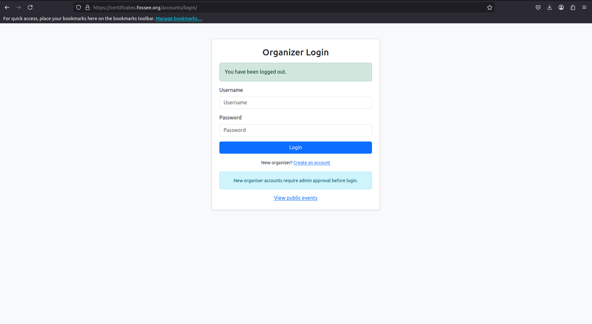

**Your account must be approved by an administrator before you can log in.** If you try to log in before approval, you will see *"Your account is pending admin approval"* or *"Invalid username/password, or your account is not approved yet."* Contact the site administrator if approval is taking long.

Once approved, log in with your username and password. You will land on the **Organizer Dashboard**, which lists all of your events and shows whether each one is **Published** or still a **Draft**.

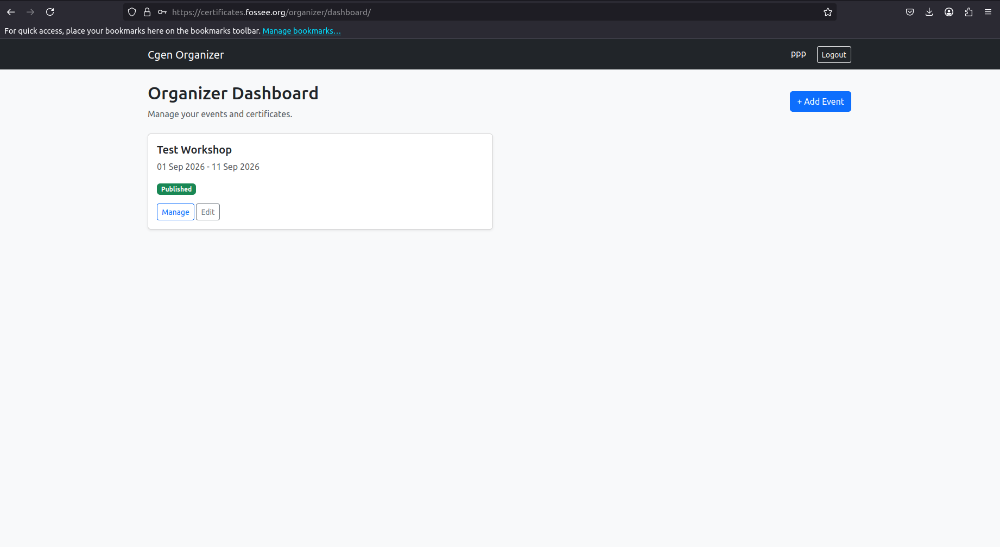

---

## 4. Create an event

1. On the dashboard, click **+ Add Event**.
2. Fill in the form:

   | Field | What to enter |
   |---|---|
   | **Name** | The event title, as it should appear to participants. |
   | **Description** | A short description of the event. This is also shown to anyone who verifies a certificate by scanning its QR code. |
   | **Start date** | When the event started (date and time). |
   | **End date** | When the event ended (date and time). |

3. Save. You will be taken to the event's page.

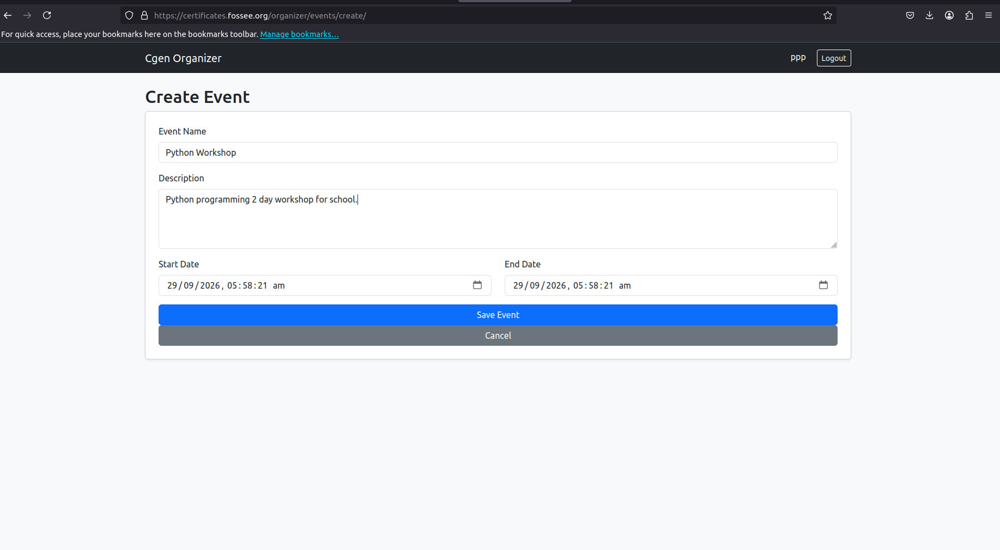

New events always start as a **Draft**. Participants cannot see the event until you publish it (Section 10).

To change these details later, open the event and click **Edit Event**.

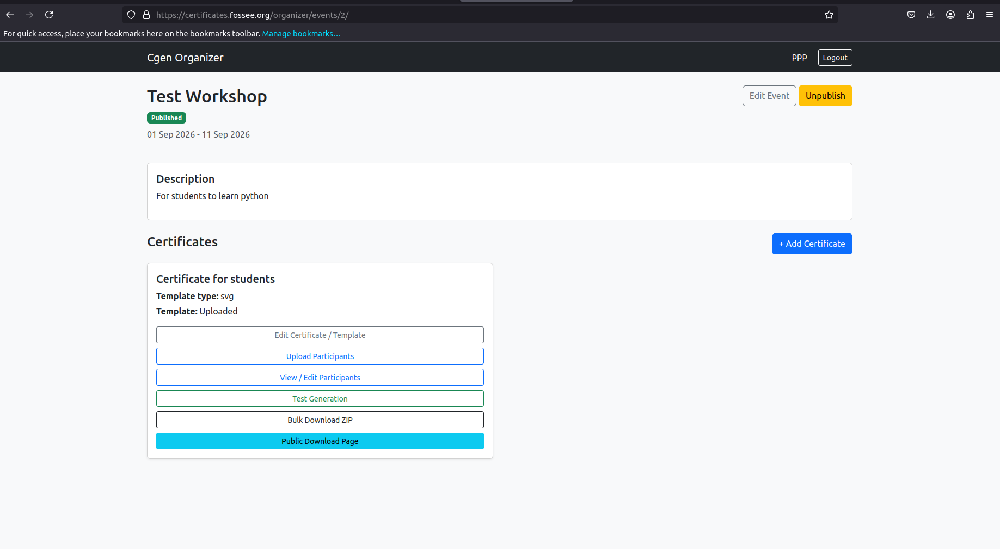

---

## 5. Prepare your certificate design (template)

The design file, called a **template**, is the most important part. It is a normal certificate design with **placeholder words** where each participant's details should go.

### 5.1 Placeholder words

A placeholder is a word that starts with a **`$`** sign. When the certificate is made, the system replaces each placeholder with that participant's information.

For example, if your template says:

> This is to certify that **$name** from **$institute** has participated in the workshop.

then Priya's certificate will read:

> This is to certify that **Priya Sharma** from **IIT Bombay** has participated in the workshop.

**Where do placeholder names come from?** From the **column headings in your participant list** (Section 7). If your list has a column called `grade`, you can write `$grade` in your template.

The system also adds two placeholders automatically. You do not put these in your participant list:

| Placeholder | What it becomes |
|---|---|
| `$serial_key` | A short unique code for this certificate (for example `a1b2`). Anyone can use it to check that the certificate is genuine. |
| `$qr_code` | The web link that the QR code points to. **LaTeX designs only.** SVG designs show the QR code differently (see 5.3). |

#### Rules for placeholders

- **Use lowercase letters.** Write `$name`, not `$Name`.
- **No spaces.** Use an underscore instead: `$course_name`, not `$course name`.
- **Spell it exactly like the column heading** in your participant list.
- **Do not use `$` for anything else** in the design. If you need a real dollar sign (for example, a price), type it twice: `$$`.
- If a placeholder has no matching column, it will appear on the certificate **as-is** (for example, a certificate that literally says "$grade"). Always test before publishing (Section 9).

### 5.2 Choose a design type: SVG or LaTeX

| | **SVG** (recommended) | **LaTeX** |
|---|---|---|
| How you edit it | Visually, like a drawing program, using the free program **Inkscape** | By editing text commands |
| Best for | Most organisers | People already comfortable with LaTeX, or when you have an existing LaTeX certificate |
| Background image | Put it directly in the design | Upload it separately in the **Background** field |
| QR code | A picture named `qrcode.png` placed in the design | Written as `\qrcode{$qr_code}` |

If you are unsure, **choose SVG** and start from the starter template in the [Appendix](#appendix-starter-templates).

### 5.3 Making an SVG design in Inkscape

[Inkscape](https://inkscape.org) is a free design program for Windows, Mac and Linux.

1. **Start from the starter SVG** in the [Appendix](#appendix-starter-templates). Save it as `certificate.svg` and open it in Inkscape.
2. **Change the look.** Edit the title, colours, fonts, border and logos as you like.
3. **Keep the placeholders.** Make sure words like `$name`, `$institute` and `$serial_key` stay where you want the details to appear.
4. **Keep the QR code box.** The starter template has a box for the QR code, which shows as a broken or empty image in Inkscape. This is expected. The system puts the real QR code there when it makes each certificate. You can move and resize this box, but do not delete or replace it.
5. **Save** as SVG (**File → Save As → Inkscape SVG** or **Plain SVG**).

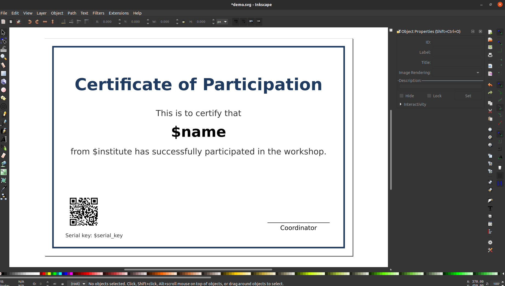

**Tips for SVG designs**

- **Type each placeholder in one go, in one style.** If you make half of `$name` bold, Inkscape splits the word in two and the system can no longer find it. If in doubt, delete the placeholder and type it again.
- **Click once to create text; do not drag a text box.** Dragged text boxes may not appear in the final certificate.
- **Centre-align name text.** Names are of different lengths. Set the text alignment to **centre** so every name stays centred on the page.
- **Never use "Object to Path" on a placeholder.** It turns the text into a shape, and the system can no longer replace it. You *can* use it on fixed text, such as the title, to keep a special font looking exactly right.
- **Use common fonts for placeholder text** (for example Arial, DejaVu Sans, Liberation Serif). An unusual font may be swapped for a plain one on the server.
- **Embed logos and pictures.** When you import a logo, choose **Embed**, not **Link**. The only picture that should be linked is the QR code box.
- **Size:** set the page to A4 landscape (297 × 210 mm) unless you need something else.

### 5.4 Making a LaTeX design

1. Start from the starter LaTeX template in the [Appendix](#appendix-starter-templates), or from an existing certificate.
2. Change the wording as needed. Keep the placeholders (`$name`, `$institute`, and so on).
3. Keep the QR code line: `\qrcode[height=2.5cm]{$qr_code}`.
4. Save it as a file ending in `.tex`.

<!-- TODO: explain how a LaTeX template refers to the uploaded Background image, once confirmed. -->

### 5.5 Make a note of your placeholders

Write down every placeholder you used, without the `$`. You will enter this list in the **Variables** field in the next step, for example:

```
['name', 'grade', 'institute']
```

---

## 6. Add the certificate to your event

1. Open your event from the dashboard (click **Manage**).
2. Under **Certificates**, click **+ Add Certificate**.
3. Fill in the form:

   | Field | What to enter |
   |---|---|
   | **Certificate Description** | A short name for this certificate, for example *"Participation Certificate"* or *"Speaker Certificate"*. |
   | **Template Type** | **SVG Template** or **LaTeX Template**, matching your design file. |
   | **Template File** | Upload your `.svg` or `.tex` design. |
   | **Background** | **LaTeX only:** upload the background image (`.png` or `.jpg`). Leave empty for SVG designs. |
   | **Variables** | The list of placeholders used in your design, in this format: `['name', 'grade', 'institute']` |

4. Click **Save Certificate**.

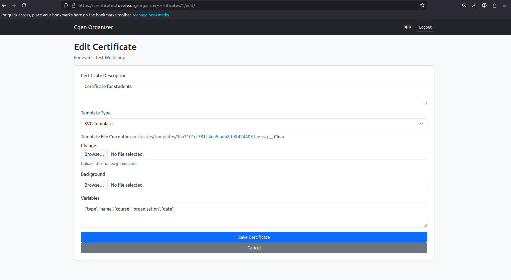

The certificate now appears on the event page with these buttons:

| Button | What it does |
|---|---|
| **Edit Certificate / Template** | Change the description, upload a new design, and so on. |
| **Upload Participants** | Upload your participant list (Section 7). |
| **View / Edit Participants** | See, correct, or remove participants (Section 8). |
| **Test Generation** | Make a sample certificate for one participant (Section 9). |
| **Bulk Download ZIP** | Download every participant's certificate at once (Section 11). |
| **Public Download Page** | The page you share with participants (Section 10). |

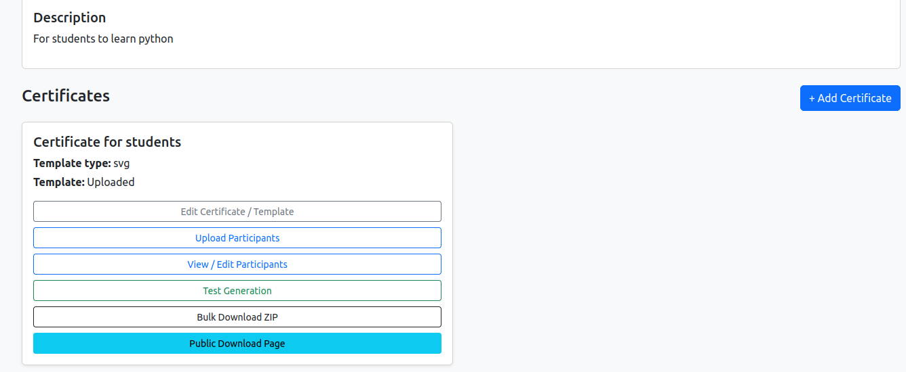

---

## 7. Prepare and upload the participant list

### 7.1 Make the list in a spreadsheet

Use Excel, Google Sheets or LibreOffice Calc. Put **one participant per row**, and **column headings in the first row**.

| email | name | institute | grade |
|---|---|---|---|
| priya@example.com | Priya Sharma | IIT Bombay | A |
| rahul@example.com | Rahul Verma | KCCMS | B+ |

**Rules for the list**

- The columns **`email`** and **`name`** are **required**.
- Every other column heading becomes a placeholder you can use in your design (`institute` → `$institute`).
- **Column headings: lowercase, no spaces.** Use `course_name`, not `Course Name`.
- **Participants download by typing this email**, so check it is correct. Capital letters don't matter.
- **The same email can appear on several rows**, for example one person who completed two courses. That person gets all their certificates together in one ZIP file.
- **Do not add a column called `serial_key` or `qr_code`.** The system fills these in itself.
- **Any characters are fine in names and other details**, including `&`, `%`, `#` and accented or Indian-language letters. (Make sure your design uses a font that has those letters.)
- **Only include information you are happy for others to see.** Anyone who scans a certificate's QR code sees the details from that participant's row (see Section 12). Do not include phone numbers, addresses or other private information unless it is needed on the certificate.

### 7.2 Save it as a CSV file

A CSV file is a simple version of a spreadsheet that the system can read.

- **Excel:** File → Save As → choose **CSV UTF-8 (Comma delimited) (\*.csv)**.
- **Google Sheets:** File → Download → **Comma-separated values (.csv)**.
- **LibreOffice Calc:** File → Save As → **Text CSV (.csv)**. When asked, choose **UTF-8** and **comma** as the separator.

If you open the CSV in Notepad, it should look like this, **with no spaces after the commas**:

```
email,name,institute,grade
priya@example.com,Priya Sharma,IIT Bombay,A
rahul@example.com,Rahul Verma,KCCMS,B+
```

### 7.3 Upload it

1. On the event page, find your certificate and click **Upload Participants**.
2. Choose your CSV file and click **Upload CSV**.
3. You should see **"Participants uploaded successfully."**

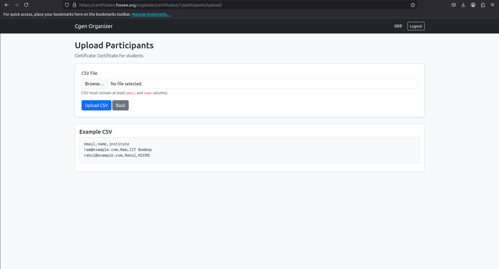

**Uploading again:** you can upload another CSV at any time, for example to add late registrations.

- Rows that are **exactly the same** as someone already on the list (same email and same details) are **skipped**, so uploading the same file twice is safe.
- Every other row is **added**, including a row with an email that is already on the list but different details.
- To **correct** someone's details, don't upload them again; use **Edit** (Section 8). Otherwise they get a second certificate.
- People who are **missing from the new file are not removed**. To remove someone, delete them (Section 8).

---

## 8. Check and correct participants

Click **View / Edit Participants** to see everyone on the list, with their email, name and other details.

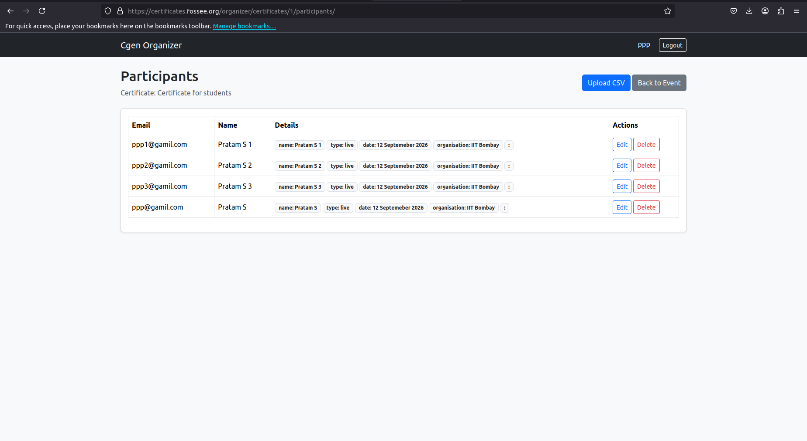

### Correct a participant's details

1. Click **Edit** next to the participant.
2. Change the **email** if needed.
3. The **details** box shows their information in this format:

   ```
   {
     "name": "Priya Sharma",
     "institute": "IIT Bombay",
     "grade": "A"
   }
   ```

   Change only the text **inside the quotation marks on the right-hand side**. Keep all the quotation marks `"`, colons `:`, commas `,` and curly brackets `{ }` exactly as they are. If you see *"Details must be valid JSON"*, a quotation mark or comma has been removed by mistake. Check it against the example above.

4. Save. Their certificate is made again with the new details the next time it is downloaded.


### Remove a participant

Click **Delete** next to the participant and confirm. They will no longer be able to download a certificate.

---

## 9. Test the certificate

**Always test before publishing.**

1. On the event page, click **Test Generation** for your certificate.
2. Choose a participant from the list.
3. Click **Generate Test Certificate**. The PDF opens or downloads.

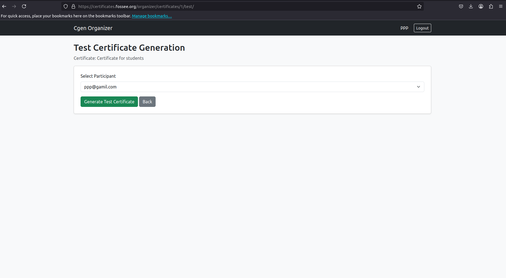

Check the test certificate carefully:

- [ ] Every placeholder has been replaced. No `$` words remain.
- [ ] Long names fit on the page and stay centred.
- [ ] The QR code appears. Scan it with your phone: it should open a page confirming the certificate is genuine.
- [ ] The serial key is shown.
- [ ] Logos, background and fonts look right.

**Tip:** test with the participant who has the **longest name** and with anyone whose details contain unusual characters.

If you see *"Certificate generation failed or participant not found"*, see [Troubleshooting](#14-troubleshooting).

---

## 10. Publish and share the download link

When the test certificate looks right:

1. On the event page, click **Publish**. The event status changes from **Draft** to **Published**, and the event appears in the public list of events.
2. Click **Public Download Page** for the certificate and copy the link from your browser's address bar.
3. Share this link with your participants by email, WhatsApp, your website, and so on.

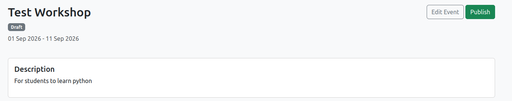

To take an event down, click **Unpublish**. You can publish it again at any time.

**Suggested message to participants:**

> Your certificate for *[event name]* is ready. Open this link and enter the email address you registered with: *[download link]*

---

## 11. Download all certificates at once

If you want to email certificates yourself or keep a copy:

1. On the event page, click **Bulk Download ZIP**.
2. Wait while the certificates are made. This can take a few minutes for a large list.
3. A file called `certificates.zip` downloads. Inside, each certificate is named after the participant's email address, for example `priya@example.com.pdf`. If an email has several certificates, they are numbered: `priya@example.com-1.pdf`, `priya@example.com-2.pdf`.

**Check the number of files.** If a certificate cannot be made for someone (for example, because of an unusual character in their name), it is **left out of the ZIP without a warning**. If the count is lower than your participant list, find the missing people and test them individually (Section 9).

---

## 12. What participants see

### Downloading

1. The participant opens the link you shared.
2. They enter the **email address from your participant list**.
3. Their certificate downloads as a PDF. If their email has several certificates, they all download together as one ZIP file.

If the email is not on the list, they see *"The requested certificate is unavailable for your email address."* Most often this is a spelling difference between what they typed and what is in your list. Check it in **View / Edit Participants**.

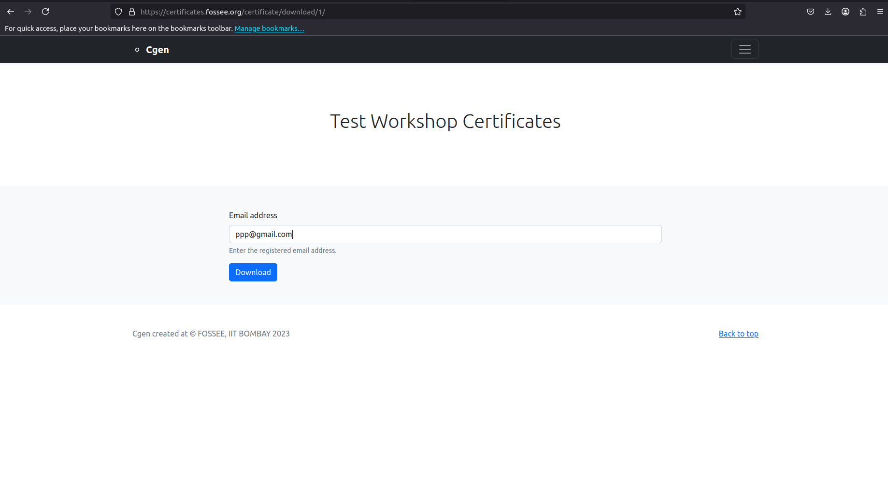

### Verifying a certificate

Anyone (for example, an employer) can check that a certificate is genuine by:

- **scanning the QR code** on the certificate, or
- going to the site's **verify** page and typing the **serial key** printed on the certificate.

The verification page shows the event name, the event description and **all details from that participant's row in your list**. This is why private information should not be put in the participant list.

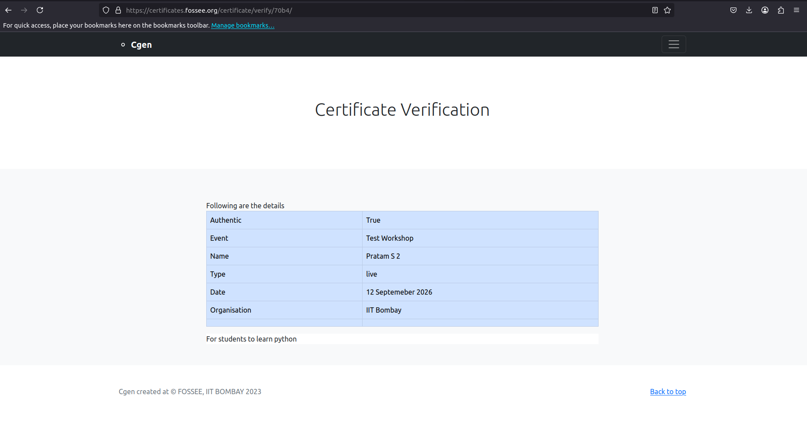

---

## 13. Making changes later

| You want to… | Do this | Effect |
|---|---|---|
| Fix a typo in the design | **Edit Certificate / Template** and upload the corrected file | Every certificate downloaded from now on uses the new design. Test again first. |
| Fix one person's details | **View / Edit Participants → Edit** | Their next download uses the corrected details. |
| Add late participants | **Upload Participants** with a CSV of the new people | They can download straight away. |
| Remove someone | **View / Edit Participants → Delete** | They can no longer download. |
| Change event dates or description | **Edit Event** | Shown on the event and verification pages. |
| Hide the event | **Unpublish** | The event is removed from the public event list. |

People who already downloaded a certificate keep their old copy. Tell them to download it again if you corrected something important.

---

## 14. Troubleshooting

| Problem | Likely cause | What to do |
|---|---|---|
| *"The CSV file does not contain the required headers"* | The `email` or `name` column is missing or misspelled. | Check the first row of your spreadsheet has `email` and `name`. |
| *"The file uploaded is not a CSV file"* or *"Bad CSV file"* | The file was saved as Excel (`.xlsx`) or with the wrong settings. | Save again as **CSV UTF-8 (comma separated)**, as in Section 7.2. |
| *"No rows in the CSV file"* | The file only has the heading row. | Add participant rows below the headings. |
| A message like *"3 -- Missing Values"* | Row 3 of your participants has no email. | Add the email to that row and upload again. |
| A `$` word appears on the certificate (for example "$grade") | The placeholder doesn't match any column heading. | Make the placeholder and the column heading exactly the same, lowercase with no spaces. |
| *"Certificate generation failed or participant not found"* | Usually a problem in the design file. | If it fails for everyone, re-check the design against the tips in Section 5. If it fails for one person only, check their details in Section 8. |
| The QR code is missing (SVG) | The QR code box was deleted or replaced in Inkscape. | Copy the QR box back from the starter template. |
| Text shows in a different font | The font isn't available on the server. | Use a common font for placeholder text, or turn fixed text into a shape with **Object to Path**. |
| The name runs off the page | The text isn't centred, or the font is too large for long names. | Centre-align the name and reduce the font size. Test with the longest name. |
| A participant can't download | Their typed email doesn't match your list. | Check the spelling in **View / Edit Participants**. |
| The ZIP has fewer certificates than participants | Some certificates could not be made. | Test the missing people individually (Section 9). |
| You can't log in after registering | Your account hasn't been approved yet. | Contact the site administrator. |

If none of these help, contact: <!-- TODO: add support contact, e.g. certificates[at]fossee[dot]in -->

---

## 15. Final checklist

- [ ] Event created with the correct name, description and dates
- [ ] Design file uses lowercase placeholders that match the CSV column headings
- [ ] SVG design still has its QR code box / LaTeX design still has `\qrcode{$qr_code}`
- [ ] **Variables** field lists every placeholder
- [ ] CSV has `email` and `name` columns, no spaces after commas, no private data
- [ ] Participant count on the **View / Edit Participants** page is correct
- [ ] Test certificate checked, including the longest name and a QR code scan
- [ ] Event **published**
- [ ] **Public Download Page** link shared with participants

---

## Appendix: starter templates

### Starter SVG template

Copy everything below into a text editor (such as Notepad), save it as `certificate.svg`, and open it in Inkscape to customise it. It is an A4 landscape certificate that uses `$name`, `$institute` and `$serial_key`, and has a box for the QR code.

```xml
<svg xmlns="http://www.w3.org/2000/svg" xmlns:xlink="http://www.w3.org/1999/xlink" width="297mm" height="210mm" viewBox="0 0 297 210">
  <rect x="0" y="0" width="297" height="210" fill="#ffffff"/>
  <rect x="8" y="8" width="281" height="194" fill="none" stroke="#1f3a5f" stroke-width="1.5"/>
  <text x="148.5" y="50" text-anchor="middle" font-family="sans-serif" font-size="16" font-weight="bold" fill="#1f3a5f">Certificate of Participation</text>
  <text x="148.5" y="75" text-anchor="middle" font-family="sans-serif" font-size="8" fill="#333333">This is to certify that</text>
  <text x="148.5" y="95" text-anchor="middle" font-family="sans-serif" font-size="14" font-weight="bold" fill="#000000">$name</text>
  <text x="148.5" y="112" text-anchor="middle" font-family="sans-serif" font-size="8" fill="#333333">from $institute has successfully participated in the workshop.</text>
  <image x="20" y="150" width="35" height="35" xlink:href="qrcode.png" href="qrcode.png"/>
  <text x="20" y="192" font-family="sans-serif" font-size="5" fill="#333333">Serial key: $serial_key</text>
  <line x1="215" y1="178" x2="275" y2="178" stroke="#000000" stroke-width="0.4"/>
  <text x="245" y="185" text-anchor="middle" font-family="sans-serif" font-size="6" fill="#000000">Coordinator</text>
</svg>
```

Matching **Variables** entry: `['name', 'institute']`

### Starter LaTeX template

Save this as `certificate.tex`. It is an A4 landscape certificate that uses `$name`, `$institute`, `$serial_key` and a QR code.

```latex
\documentclass[a4paper,landscape]{article}
\usepackage[margin=2cm]{geometry}
\usepackage{qrcode}
\pagestyle{empty}
\begin{document}
\centering
\vspace*{1.5cm}
{\Huge\bfseries Certificate of Participation}\\[1.5cm]
{\Large This is to certify that}\\[0.6cm]
{\huge\bfseries $name}\\[0.6cm]
{\Large from $institute has successfully participated in the workshop.}\\
\vfill
\begin{minipage}{0.5\textwidth}
\raggedright
\qrcode[height=2.5cm]{$qr_code}\\[0.2cm]
{\small Serial key: $serial_key}
\end{minipage}%
\begin{minipage}{0.5\textwidth}
\raggedleft
\rule{5cm}{0.4pt}\\
Coordinator
\end{minipage}
\end{document}
```

Matching **Variables** entry: `['name', 'institute']`

---
